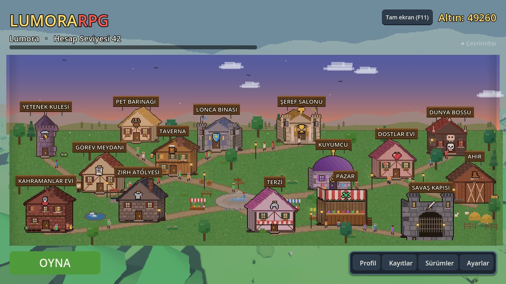
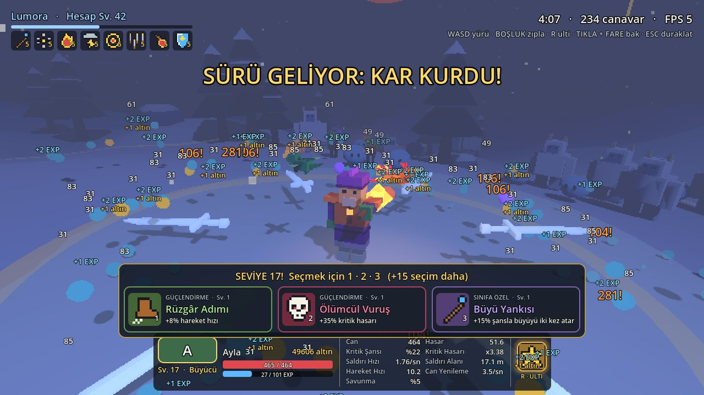
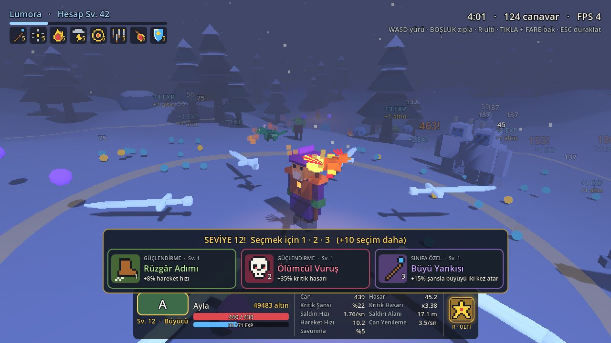
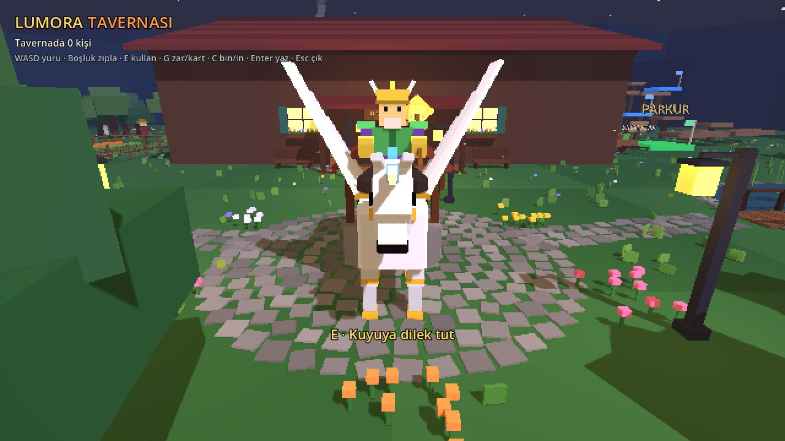
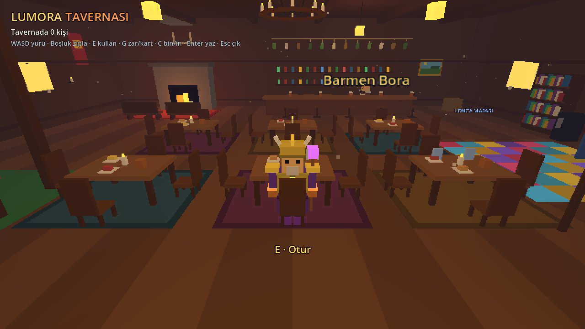
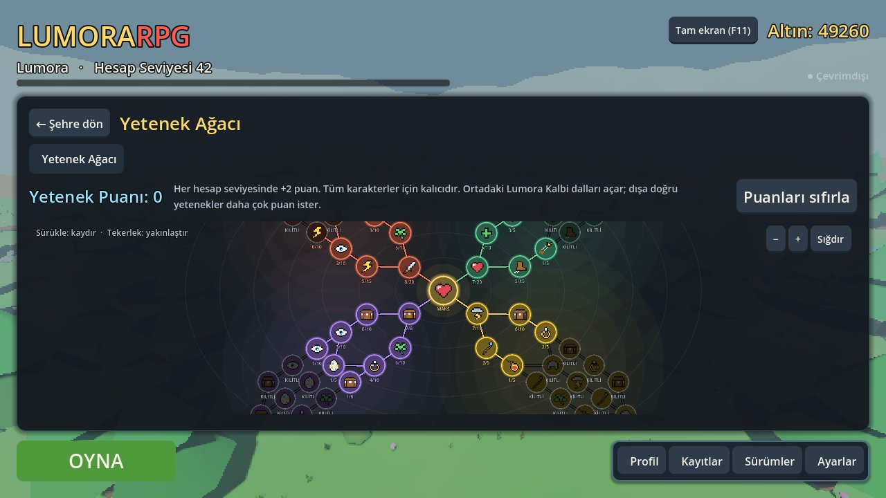
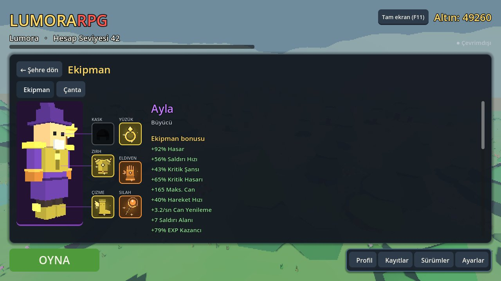
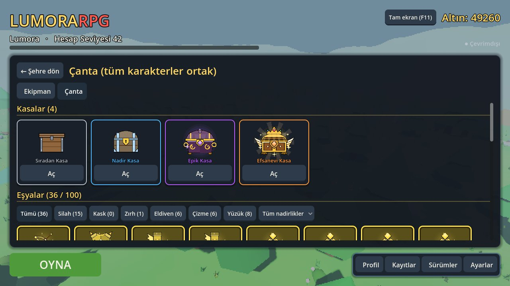
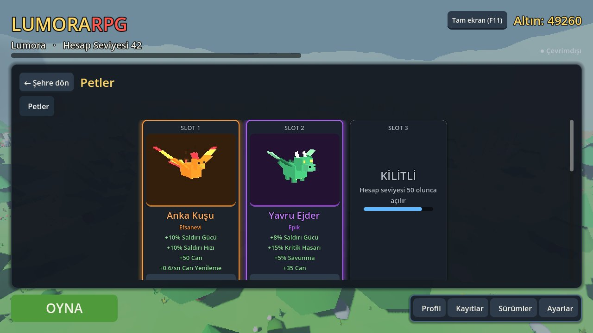
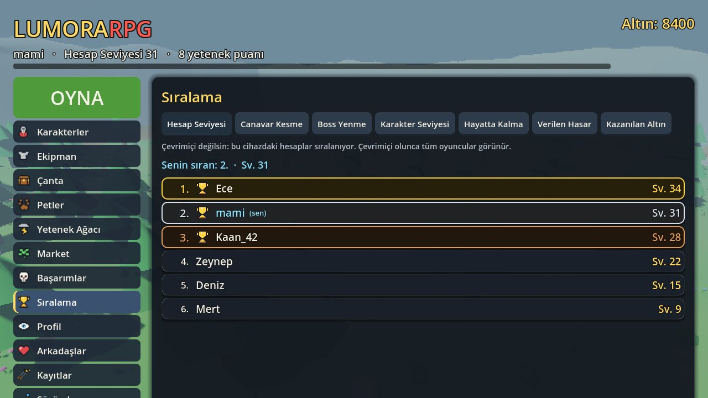

<div align="center">

# LumoraRPG

**A Megabonk-style 3D pixel-art roguelike survivor: waves of monsters, weapons that fire on their own, bosses, pets, a skill tree and live co-op with friends.**

**[Play in the browser →](https://highlvmami.github.io/LumoraRPG/)** · **[Download for Windows](https://github.com/highlvmami/LumoraRPG/releases/download/latest/LumoraRPG-windows.zip)**

[Türkçe](README.md) · English

<p>
  
  
  
  
  
  
  
</p>

</div>

You pick a character and drop onto an open map. Monsters come from every side, your weapons hit whatever gets in range, and you keep moving to stay alive. Every level you pick one of three cards to power up for that run, and a boss shows up every five minutes. When the run ends, the EXP, gold, items and chests you earned stay on your account: gear, pets and the skill tree make the next run stronger. The game is made with Godot 4.5 and runs in the browser and on Windows; online accounts and co-op go through a small Node.js server. The game itself is in Turkish.

> The online server runs on Northflank and does not go to sleep. If the server can't be reached, the game opens offline with the account saved on this device.

## Screenshots

<p align="center">
  
</p>

<p align="center">
  
  
</p>

<p align="center">
  
  
</p>

<p align="center">
  
  
</p>

<p align="center">
  
  
  
</p>

<p align="center"><sub>Town menu · Swarm ring and level-up cards · Tavern garden and inside · Skill tree · Equipment · Backpack · Pets · Leaderboard. Taken with sample data.</sub></p>

## Features

### Gameplay
- **5 maps:** Calm Forest, Beach Town, Snowy Mountains, Scorching Desert and Deadly Dungeon; every run starts on a random one. The mountains and the desert have their own monsters and boss.
- **Auto attack:** the nearest monster inside your range ring gets hit. Next to the class weapon you can carry up to 5 weapons, each with 5 levels.
- **Weapon evolution:** a maxed weapon plus its matching boost turns into a much stronger weapon with a new name and colour.
- **Level-up cards:** every level shows 3 cards without pausing the game (1 · 2 · 3 or click); boosts last for the run.
- **Swarms:** monsters start few and weak and grow past 400. Now and then a huge pack of one kind arrives and closes a ring around the player.
- **Bosses:** every 5 minutes. They mark attacks with red zones on the ground, get angrier with new attacks as their health drops, and swing their whole body into each move.
- **Dungeon gates:** step into a purple gate that opens during a run and beat its mini boss in 60 seconds for gold and a chest.
- **Day, night and weather:** a 5-minute day cycle with tougher monsters at night, plus rain, storms and fog.
- **Nightmare difficulty:** Nightmare I-III unlock at account level 8, 16 and 25; tougher monsters, 2-5x rewards.
- **Ultimate (R / Q):** each class has two, hitting every enemy on the map.

### Town menu
- The main menu is a living pixel town that follows the real clock from sunrise to night: people walk the paths, the fountain runs, chimneys smoke and lamps light up after dark.
- Every menu lives in a building: Skill Tower, Pet Shelter, Guild Hall, Hall of Fame, World Boss, Quest Square, Tavern, Friends' House, Stable, Jeweler, Heroes' House, Armory, Tailor, Bazaar and War Gate.

### Characters, items and chests
- Up to 5 characters per account: **Warrior**, **Archer**, **Mage**, **Shadow** and the team-healing **Healer**.
- 6 rarities (Common → Divine) and 6 gear slots; worn gear shows on the character.
- **Blacksmith:** upgrade an item up to +5. **Gems:** put fire, ice, poison, storm and life gems into 1-3 sockets on rare gear.
- **Shared backpack:** filter by slot and rarity; hovering shows stats compared with the worn item.
- **Chests:** bosses drop them and the Bazaar sells them; a wheel spins and stops on your prize.
- **Wardrobe:** cosmetic outfits and dyes you can try on before buying.

### Pets and mounts
- **9 pets** hatched from eggs in 4 rarities (from the Bear to the Phoenix). 3 slots open at account level 10, 25 and 50; slotted pets give stats and follow you in runs. The Pet Collection shows what you have found.
- **Stable:** Grey Horse, Wolf Companion, Sand Tiger and the winged Sky Tulpar. Ride fast around the tavern and press C to get off or back on.

### Skill tree
- The **Heart of Lumora** in the middle opens four branches: **Attack**, **Defense**, **Fortune** and the out-of-run **Treasure**. 61 skills in total, with a strong final skill at the end of each branch.
- Every account level gives 2 points; outer skills cost more. Drag to move around, use the wheel to zoom, reset any time.

### Tavern
- A 3D tavern you walk around inside and out: sit at tables, swing, dance, and chat with speech bubbles (Enter).
- The garden has a campfire, a wishing well, a pond and **fishing** (E); cook your catch in the Kitchen and eat it for a boost in the next run.
- **Parkour:** a course with checkpoints, a top-ten board and gold rewards.
- **Dice and cards:** press G to offer a gold bet to someone nearby; dice and cards fly onto the table.

### Online
- **Accounts:** username and password; your save lives on the server, so you play the same account from any device. "Remember me" skips the password.
- **Co-op:** create a room, invite a friend or share the 5-letter code (up to 4 players); when the host presses PLAY everyone plays live on the same map.
- **Duels:** the Duel Arena, played out by the server from both characters' stats, and real-time 1v1 PvP.
- **Guilds:** create or join one; guild chat, a weekly shared goal, donations and 5-level guild upgrades.
- **Weekly world boss:** one giant boss with health shared by the whole server; gold by your share of the damage.
- **Trade, leaderboards and friends:** trade items for gold; leaderboards in 7 categories; friends' online status and level.

### More
- 3 daily quests and a 7-day login reward calendar.
- 48 achievements with gold rewards, logs of the last 50 runs, version notes.
- Sound and music (set separately), graphics/camera/interface settings, full screen (F11).
- Touch controls on phones and tablets (move stick, camera drag, ULT and JUMP buttons).
- The Windows build updates itself on every start (it only downloads the small game pack).

## Controls

| Key | Action |
|---|---|
| WASD / arrow keys | Move |
| Space | Jump |
| Mouse | Turn the camera (click the game window first) |
| Mouse wheel | Zoom in / out |
| 1 · 2 · 3 | Pick a level-up card |
| R / Q | Ultimate |
| Esc / P | Pause (resume, quality, main menu, boosts) |
| F11 | Full screen |
| E | In the tavern: sit, swing, dance, fish |
| C | In the tavern: get off / on your mount |
| G | In the tavern: offer a dice or card game |
| Enter | In the tavern: chat |
| F1 | Developer menu (only on an account that entered the secret code in Settings) |

## How it works

- **Data-driven balance:** monsters, weapons, items, pets, skills and achievements live in JSON files under `data/`; changing numbers needs no code.
- **Pixel look:** the world renders into a low-resolution SubViewport and is scaled up, while the interface stays sharp at full resolution. Models are built from boxes in code; there are no image files.
- **Co-op:** the player who opened the room runs the game (enemies, damage, rewards). The server only relays messages; the host sends the state 10 times a second and the others send their moves and hits.
- **Accounts:** the server keeps passwords only as scrypt hashes and session tokens as sha256 hashes. Saved games are stored as JSONB and the newest save wins; leaderboards are computed from those saves.
- **Continuous delivery:** every PR runs the Godot tests, the server test and a two-game co-op test on GitHub Actions, and checks that the web build starts in Chrome. Merging to `main` publishes the web build to GitHub Pages and the Windows build to Releases.

## Tech stack

| Part | Technology |
|---|---|
| Game | Godot 4.5 (GDScript) |
| Server | Node.js, `ws`, `pg` |
| Database | PostgreSQL (server memory without one) |
| Hosting | GitHub Pages (web), GitHub Releases (Windows), Northflank (server), Neon (database) |
| Tests | Godot headless tests, Node server test, headless Chrome |

## Project layout

| Folder | What |
|---|---|
| `scripts/` | Game code: player, enemies, weapons, progression, UI, networking |
| `data/` | Balance and content (JSON) |
| `scenes/` | Start-up (updater) and main scene |
| `server/` | Online server: accounts, rooms, invites, leaderboards, co-op relay |
| `tests/` | Automated tests |
| `docs/` | Roadmap and screenshots |

## Running it

1. Download [Godot 4.5](https://godotengine.org/download) (standard build), **Import** `project.godot` and press **F5**.
2. To try the server locally:

```bash
cd server
npm install
node index.js                  # ws://localhost:8080
```

Start the game with `-- --server=ws://localhost:8080` to use it. With `DATABASE_URL` set, accounts are kept in PostgreSQL.

Tests:

```bash
godot --headless --path . -s res://tests/smoke_test.gd
godot --headless --path . -s res://tests/coop_test.gd    # needs node
(cd server && node test.js)
```

Design and roadmap (Turkish): [docs/ROADMAP.md](docs/ROADMAP.md)
